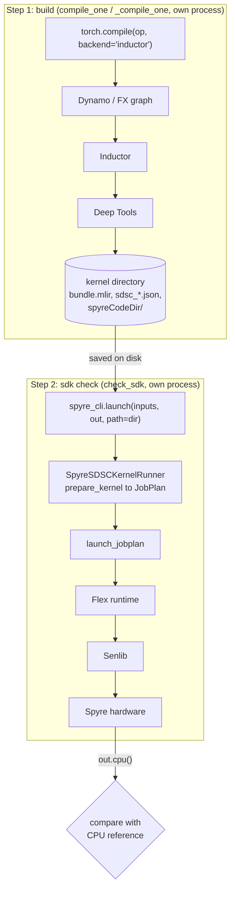

# additional_tests: mental model

This folder holds extra spyre-cli suites. This page explains where they sit in the stack,
so you can tell what a pass or a failure is actually exercising.

## Background

These tests belong to the HAPs assignment (High Performance ASIC Prototyping System). Its
purpose is to test the upcoming Spyre 2.0 card in its pre-silicon phase. Pre-silicon means
running torch-spyre test programs against an emulated Spyre 2.0 card: RTL code loaded into
an FPGA that mimics the card.

That emulation is not available yet. The system is being set up with a Spyre 1.0 card and the
Spyre 1.0 software stack, so every device result recorded here (see `bf16/results.md` and
`fp32/result.md` under `vector-trancendental-math-workloads/`) comes from Spyre 1.0 and says nothing
about Spyre 2.0 yet.

## The stack

```text
                    PYTORCH
                       │
                       │ torch.compile()
                       ▼
              ┌─────────────────┐
              │ TorchDynamo /   │
              │ FX Graph        │
              └────────┬────────┘
                       │
                       ▼
              ┌─────────────────┐
              │    Inductor     │
              │                 │
              │ Graph lowering  │
              │ Optimization    │
              │ Fusion          │
              └────────┬────────┘
                       │
                       ▼
              ┌─────────────────┐
              │   Deep Tools    │
              │                 │
              │ Spyre lowering  │
              │ Kernel/codegen  │
              │ Scheduling      │
              │ Binary creation │
              └────────┬────────┘
                       │
                 Spyre Binary
                       │
═══════════════════════╪════════════════════════
                       │
                    RUNTIME
                       │
                       ▼
              ┌─────────────────┐
              │  Flex Runtime   │
              │                 │
              │ Load/manage     │
              │ executable      │
              │ Schedule/launch │
              └────────┬────────┘
                       │
                       │ API / commands
                       ▼
              ┌─────────────────┐
              │     Senlib      │
              │                 │
              │ User-space HW   │
              │ interface       │
              │ DMA             │
              │ device commands │
              └────────┬────────┘
                       │
                       ▼
              ┌─────────────────┐
              │ Spyre Hardware  │
              └─────────────────┘
```

The line in the middle is the key boundary. Above it, the program is turned into a binary
(compile time). Below it, that binary is loaded and run on the card (runtime).

## Where the SDK path fits

The SDK path is `spyre_cli.launch(...)`. It sits **below the line**. It skips Dynamo, Inductor and
Deep Tools. It starts from a binary that was built earlier and hands it to the runtime.



Step 1 does two things. It builds the binary, and it also runs the op once on the device through
the normal `torch.compile` path. That first run already goes through the runtime, which is why a
numeric mismatch in upstream's `_compile_one` stops the build with
`torch.compile result does not match CPU` and leaves no sdk result.

Step 2 re-runs the saved kernel through the runtime only. It is the same final stage that
`torch.compile` uses (`SpyreSDSCKernelRunner`, in `torch_spyre/execution/kernel_runner.py`), fed
from a directory instead of from the compiler. spyre-cli's `spyre launch` command enters at the same
point (`spyre_cli/core.py::_launch`) but fills the inputs with ones. The SDK path passes real inputs
and reads the output back, which is what these suites need.

| Layer | Where it shows up in this repo | Exercised by |
|---|---|---|
| Dynamo / FX graph, Inductor | `torch.compile(...)` in the build step | build step only |
| Deep Tools | produces the kernel directory in the build step | build step only |
| Flex runtime | `launch_jobplan`, `JobPlan` (`torch_spyre/csrc/job_plan.cpp`) | build step and sdk step |
| Senlib, hardware | below the runtime | build step and sdk step |

## Why this matters for reading results

- **Compile FAIL, sdk SKIP.** The mismatch was found by the first run in step 1, which goes through
  the whole stack. Nothing below the line can be blamed separately, and the standalone launch was
  never tried.
- **Compile PASS, sdk FAIL.** The same kernel ran correctly once through `torch.compile` but not when
  launched alone from its directory. That points at the launch path (runtime and below), not at
  compilation.
- **Both PASS.** The result is correct end to end for those inputs and tolerance.
- **A kernel only loads on the toolchain that built it** (upstream `examples/README.md`). Build and
  launch on the same stack. This matters when the stack changes from Spyre 1.0 to the pre-silicon
  emulation.

## Layout

```text
additional_tests/
├── README.md                          this page
├── base/                              shared code: run_all.py, check.py, criteria.py, sweeps.py, workloads_common.py
└── vector-trancendental-math-workloads/
    ├── README.md                      gap coverage, criteria, expected findings
    ├── test_workloads.py              CPU tests (no device needed)
    └── <suite>/<suite>_examples.py    one registry per suite
```

Run a suite from this folder on a machine with a card:

```bash
python3 base/run_all.py bf16
```

## Corrections to the stack diagram (from this repo's docs)

The diagram above is the model as given. Two points differ from what this repo's docs say, so
check them with the runtime team before treating the diagram as final:

1. **Where "Spyre lowering" and "Kernel/codegen" live.** `docs/source/getting_started/glossary.md` and
   `how_torch_spyre_works.md` put the lowering and the SuperDSC (`sdsc_*.json`) generation in
   Torch-Spyre, which plugs into Inductor. Deep Tools is described as the closed backend that
   consumes SuperDSC and emits the device binary. On that reading, "Spyre lowering" and
   "Kernel/codegen" belong in the Inductor box, and Deep Tools covers binary creation and the
   data-movement scheduling.
2. **Flex to Senlib.** The docs describe Flex as the device runtime that owns device memory and
   issues launches, and `senlib` as the Spyre driver. The repo code calls Flex directly
   (`flex::` in `job_plan.cpp`). The hand-off from Flex to Senlib happens outside this repo, so
   the arrow between them is not verified here.
